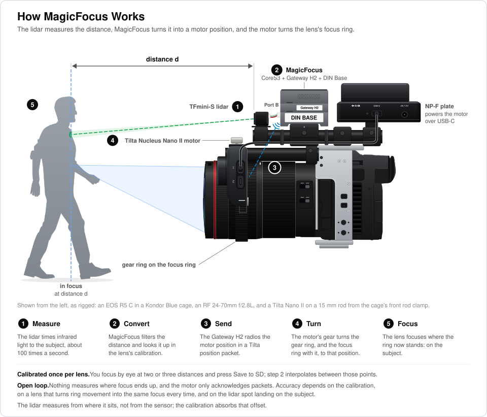
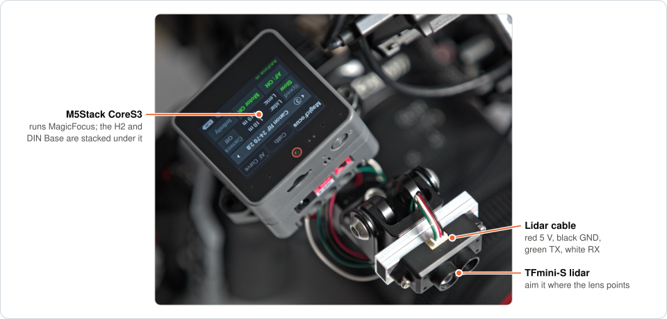
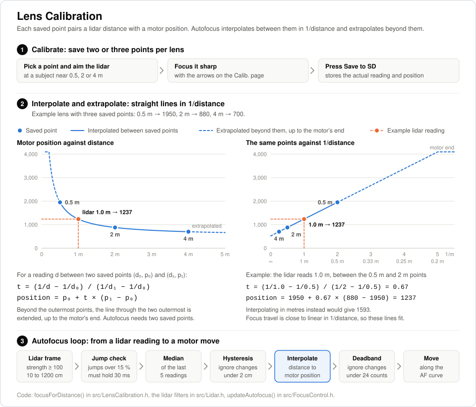

# MagicFocus

🌐 **Website:** [kenfilms.github.io/MagicFocus](https://kenfilms.github.io/MagicFocus/)


[](LICENSE)

**Customizable characteristics Lidar autofocus** for a **Tilta Nucleus Nano II** focus motor, driven from an **M5Stack Core2** or
**CoreS3** with a stacked **Module Gateway H2** as the radio.

A **TFmini-S lidar** measures the subject distance, a per-lens calibration curve maps that distance to a
motor position, and the **Gateway H2** impersonates the **Nucleus Nano II hand wheel ("The Knob") or handle** on
IEEE 802.15.4 to control the motor. No camera connection is needed, so this works with any camera
and any lens that takes a follow-focus gear. Focus-by-wire lenses, such as **Canon's RF lenses**, need a
camera setting changed first; see [Focus-by-wire lenses](#focus-by-wire-lenses).

[](images/MagicFocus_cam_overview.jpg)

## Menus and buttons

[](images/MagicFocus_closeup_menu.jpg)

Every button acts as soon as you tap it, and holding it does nothing more, with two exceptions:
holding the lens name for a second locks or unlocks the lens, and holding a calibration arrow keeps
the motor turning, faster after a second.

![Menus and buttons: the MagicFocus, Calib., AF Curve and Good to know pages as they look on the screen, numbered only where something isn't obvious. Hold the lens name for a second to lock or unlock the lens; the number in front of it is its slot in lenses.txt. Tap the battery for volts or percent. On the MagicFocus tab, tap the readout to switch between numbers and a 10-second graph, shown enlarged, of the distance to the subject in orange and the distance the lens is focused at in blue; Camera links a Blackmagic camera on a Core2, which picks the lens even when it is locked; tap the motor status to check the radio again. On the Calib. tab, tap the step for 0.5, 2 or 4 m, where a green dot marks a saved point, hold an arrow to keep the motor turning, and read the motor position in the middle and the lidar distance at the lower left. On the AF Curve tab, each sketch shows how the lens gets to focus, and Speed sets how fast. Drag the Good to know text to scroll. On a Core2, a PIN keypad appears the first time a Blackmagic camera pairs, and holding button C for 2 seconds switches it off](images/menus.svg)

## Why MagicFocus

- **You choose how focus moves.** Five autofocus curves, Snap, Overshoot, Creep, Smooth and Linear,
  each slow or fast, so a focus change looks the way the shot needs. Other lidar autofocus systems
  typically let you set only how fast focus moves. See [Focus curves](#focus-curves).
- **Any camera, almost any lens.** The lidar measures the distance itself, so nothing connects to
  the camera. Focus-by-wire lenses, such as Canon's RF lenses, work too, with one camera setting.
- **The motor you already have.** MagicFocus drives a stock Tilta Nucleus Nano II motor by radio,
  as its own hand wheel does: no modification, and no cable to the motor.
- **Off-the-shelf parts.** An M5Stack CoreS3 or Core2, a Gateway H2 module and a
  TFmini-S lidar. A CoreS3 even flashes the H2 stacked on it. Soldering may be required for creating a cable to connect lidar and DIN Base.
- **Calibrated by eye, lens by lens.** Focus each lens at a few distances with the camera's focus
  aids and save; MagicFocus interpolates between the points.
- **You see what it does.** A live graph of the lidar and lens distances, and a radio status that
  shows whether the motor is answering.

## How it works



## Required hardware

* **Tilta Nucleus Nano II motor** (WLC-T05-MK)
* A follow-focus gear ring on each lens's focus ring. A rubber one works best, such as Tilta's
  seamless focus gear rings.
* **Tilta Nucleus Nano II Hand Wheel Controller** ("The Knob", WLC-T05) OR 
**Tilta - Nucleus-N II Control Handle** (WLC-T05-CH) — needed once, to pair and configure the motor
* **M5Stack Core2** OR **CoreS3 (recommendation)**
* **microSD card** for the M5 (FAT32 with an MBR partition map), which stores the lens database,
  `lenses.txt`: each lens's name and calibration points
* **M5Stack Module Gateway H2** (ESP32-H2, SKU M141)
* M5Stack ESP32 Downloader OR pretty much any USB-to-TTL Adapter with 3.3V logic (requires manually connecting G9 to GND), to flash the H2 once (not needed with a CoreS3, which can flash the stacked H2 itself; see [Flash the Gateway H2](#1-flash-the-gateway-h2))
* **Benewake TFmini-S lidar**

**Optional:** The M5Stack DIN Base provides battery power for the Core, an onboard on/off switch,
and convenient connection ports for the lidar.

## Wiring

The board is detected at startup and picks its pin layout from [src/Board.h](src/Board.h). To force
one, set `BOARD_SELECTION` in [src/Config.h](src/Config.h).

TFmini-S cable colors: red = 5V, black = GND, green = TX, and white = RX.

**CoreS3 (recommendation)**


| CoreS3 | | Peripheral |
| --- | --- | --- |
| G8 (DIN Base Port B) | ← | TFmini-S TX (green) |
| G9 (DIN Base Port B) | → | TFmini-S RX (white) |
| G10 (stack) | ← | Gateway H2 U0TXD |
| G17 (stack) | → | Gateway H2 U0RXD |
| G7 (stack) | → | Gateway H2 enable |
| G18 (stack) | → | Gateway H2 boot |

The Gateway H2 needs no extra wiring on a CoreS3: stack it between the CoreS3 and its DIN Base.
Port C (G18/G17) carries the H2's boot and RX lines, so plug the lidar into the DIN Base's Port B —
the same cable fits.

[](images/MagicFocus_Lidar.jpg)

**Core2**

| Core2 | | Peripheral |
| --- | --- | --- |
| G13 / RXD2 (Port C) | ← | TFmini-S TX (green) |
| G14 / TXD2 (Port C) | → | TFmini-S RX (white) |
| G32 (Port A) | → | Gateway H2 U0RXD (GPIO23) |
| G33 (Port A) | ← | Gateway H2 U0TXD (GPIO24) |

The stacked Gateway H2's UART and boot pin land on G35, G14 and G13, which Port C shares with the
lidar, so on a Core2 the serial link is wired to Port A and the module's download header instead;
the stack connector can still supply power.

## Setting up

![Flashing and setup: 1, flash the H2 through the CoreS3 with Core2Programmer and esptool, or with the ESP32 Downloader on a Core2; 2, flash MagicFocus onto the CoreS3 or Core2, which restarts the H2 into the bridge; 3, set Tilta CH1 on the Knob or handle, pair the motor with its button, switch the Knob or handle off and check that the CoreS3 shows Motor OK; 4, for each lens, set it to MF, on a focus-by-wire lens set the camera's focus ring to rotation degree and disable auto power-off, and calibrate the motor to the lens with its button; 5, for each lens, pick it, save at least two calibration points and test them with AF on](images/setup-steps.svg)

### 1. Flash the Gateway H2

Open [h2_firmware/TiltaBridgeH2](h2_firmware/TiltaBridgeH2) in the Arduino IDE with
arduino-esp32 ≥ 3.1.1 and select *ESP32H2 Dev Module*, flash size *2MB*, flash mode *DIO* and
partition scheme *custom* (the included `partitions.csv`). Then flash it in one of two ways.

**Through the CoreS3.** A CoreS3 can flash the H2 stacked on it, with no other hardware:

1. Choose **Sketch → Export Compiled Binary**. The bridge firmware lands in the sketch's
   `build/esp32.esp32.esp32h2` folder as `TiltaBridgeH2.ino.bootloader.bin`,
   `TiltaBridgeH2.ino.partitions.bin` and `TiltaBridgeH2.ino.bin`.
2. Upload [h2_firmware/Core2Programmer](h2_firmware/Core2Programmer) to the CoreS3 with the Arduino
   IDE: board *M5CoreS3* with *USB CDC On Boot* enabled (the default), and the M5Unified library.
   It switches on the H2's power, resets the H2 into its ROM download mode and passes the CoreS3's
   USB serial port through to the H2. The screen stays black while it runs.
3. Write the bridge firmware with [esptool](https://github.com/espressif/esptool) 5
   (`pip install esptool`) through the CoreS3's port, `/dev/cu.usbmodem…` on a Mac, `/dev/ttyACM…`
   on Linux or `COM…` on Windows:

   ```sh
   cd h2_firmware/TiltaBridgeH2/build/esp32.esp32.esp32h2
   esptool --chip esp32h2 --port /dev/cu.usbmodem101 --baud 115200 \
     --before no-reset --after no-reset --no-stub \
     write-flash --flash-mode dio --flash-freq 48m --flash-size 2MB \
     0x0 TiltaBridgeH2.ino.bootloader.bin 0x8000 TiltaBridgeH2.ino.partitions.bin \
     0x10000 TiltaBridgeH2.ino.bin
   ```

   This takes about half a minute. esptool's flasher stub fails through the pass-through, so
   `--no-stub` writes through the H2's ROM loader instead. The `no-reset` options are needed because
   esptool's own reset would restart the CoreS3, not the H2, which is already in download mode.
4. Go on with [step 2](#2-flash-magicfocus-onto-the-cores3-or-core2): MagicFocus replaces
   Core2Programmer on the CoreS3, and at startup it finds the H2 still in download mode and
   restarts it into the bridge firmware.

If esptool can't connect, or a write fails partway, press the CoreS3's reset button once and run
esptool again: Core2Programmer starts over and puts the H2 back into download mode. A failed write
is harmless, as the H2's download mode is in its ROM.

If the CoreS3's port is listed but uploads to it time out, hold its reset button for about three
seconds, until the green LED inside lights, and upload again. After an upload in this mode the
CoreS3 stays in its bootloader; start it with
`esptool --port /dev/cu.usbmodem101 --before no-reset --after watchdog-reset chip-id`.

**With the ESP32 Downloader.** Also select *Erase All Flash Before Sketch Upload: Enable*, and
upload through the H2's download header with the ESP32 Downloader. Use this route with a Core2.

### 2. Flash MagicFocus onto the CoreS3 or Core2

MagicFocus itself, the firmware in [src](src), runs on the M5Stack CoreS3 or Core2; the H2 only
runs the bridge from step 1. Connect the CoreS3 or Core2 to the computer by USB-C and upload
MagicFocus with [PlatformIO](https://platformio.org), using the environment for your board:

```sh
pio run -e m5stack-cores3 -t upload   # CoreS3 (ESP32-S3)
pio run -e m5stack-core2 -t upload    # Core2 (ESP32)
```

### 3. Pair the motor with the Knob or the Control Handle

The motor needs pairing once, on Tilta **CH1** (802.15.4 channel 12), with either the Nucleus Nano II
hand wheel ("the Knob") or the Nucleus-N II Control Handle. Both send with the same radio
addresses, so the H2 drives a motor paired with either one.

With the Knob, as described by [strawlab/tilta-n2-control](https://github.com/strawlab/tilta-n2-control):

1. Turn on the Knob, go to Menu → Connect → 2.4G → Channels and activate **CH1**.
2. Power the motor, short-press its button until the LED is **pink** (focus motor).
3. Double-click the motor button to enter pairing mode, tap Search on the Knob and select the motor.
4. Set sensitivity/torque to taste — those settings stay in the motor.
5. **Turn the Knob off** (see the note below).

With the Control Handle, pair the motor with the handle on CH1 instead. The handle has no
sensitivity or torque settings.

> [!IMPORTANT]
> Switch the Knob or handle off before using MagicFocus, and keep it off. Even when nobody touches
> it, it keeps sending packets of its own, which conflict with the H2's: in testing with the handle
> left on, the motor failed to acknowledge up to about 40% of the H2's packets.

Once the Knob or handle is off, the right-hand button on the **MagicFocus** tab should show
**Motor OK** within a second or two. `No motor` means the motor isn't answering: check that it's
switched on and paired on CH1.

### 4. Set up the camera and lens

Do this for every lens, before calibrating it in [step 5](#5-calibrate-a-lens):

1. **Set the lens to manual focus.** On Canon lenses, set the AF/MF switch on the lens to **MF**;
   lenses without a switch are set to MF in the camera's menu. In AF, the camera's own autofocus can
   move focus as well, and some lenses ignore the focus ring.
2. **On a focus-by-wire lens, make the focus ring linear and keep the camera on.** In the camera
   menu, set **RF lens MF focus ring sensitivity** to **Linked to rotation degree**, and disable
   **auto power-off**: while the camera sleeps, the ring does nothing and the motor's turns are lost.
   More under [Focus-by-wire lenses](#focus-by-wire-lenses).
3. **Calibrate the motor to the lens's focus ring**, as described next. The motor's range has to
   match this lens's ring, so calibrate it again after changing lenses.

#### Calibrating the motor to the lens

Long-press the motor's button for about 3 seconds. The motor then turns the focus ring to both
ends of the lens, until it meets the hard stops, and keeps that range. MagicFocus's positions are
counted within it, so its ends must sit exactly at the lens's ends.

Many lenses have no hard stops: many Canon EF lenses, and all focus-by-wire lenses, such as Canon's
RF lenses, whose focus rings keep turning past the ends. With those, stop the rotation yourself at
both ends, exactly where the lens reaches close focus and infinity:

- If the lens has a focus distance window, watch it reach the close and infinity marks.
- Canon's RF lenses have no distance window, but a Canon camera can show the focus distance on its
  screen:
  - In photo mode, with the lens in manual focus.
  - On the EOS R5 C in video mode, once you turn on **Object Distance (Numeric)** or
    **Object Distance (Bar)** under **Custom Display 1** on page 5 of the **Monitoring Setup**
    menu.

### 5. Calibrate a lens

Each lens has its own calibration slot, numbered 1 to 8 in the ring beside its name; pick it with
the arrows on either side. Hold the lens name for a second to lock the lens: a red padlock appears
next to the name, and the arrows can't switch the lens until you hold the name again. A lens read
from a Blackmagic camera (see below) still switches it, and the lock moves to that lens. MagicFocus
remembers the locked lens across restarts. The lenses live in a list, `lenses.txt` in the SD card's `tiltafocus`
folder: a line per lens with its slot and name, followed by its calibration points, up to six, each
as the distance in metres and the motor position:

```
1: Canon EF 50mm f/1.4
  0.5 m: 1950
  2 m: 880
  4 m: 700
2: Canon EF 100mm f/2.8 Macro
4: Canon RF 24-70mm f/2.8L
```

Name the slots there before calibrating; the **Calib.** tab then adds the points, and MagicFocus
writes the list back after every saved point. Names have at most 31 characters. A lens line that is
only a name keeps the slot that already has that name, or else takes the first slot with neither a
name nor points, and lines starting with `#` are ignored. A numbered line names its slot even if the
slot holds another lens's points, so keep the numbers of lenses you have calibrated.

[lenses.txt](lenses.txt) in this repository's top folder is built into the firmware and used when
the card has no list of its own; it never takes a slot that already holds a calibration. To change
the list without reflashing:

- **On the SD card:** put the card in the computer, edit `tiltafocus/lenses.txt`, and put it back.
  MagicFocus reads the list at startup.
- **Over USB, with the card left in:** run `python3 tools/lenses.py pull` to fetch the M5's list,
  names and points, into the repository's `lenses.txt`, edit it, and send it back with
  `python3 tools/lenses.py push`. MagicFocus saves it on the card and applies it at once.
  `python3 tools/lenses.py show` lists every slot with its number of points. The script needs
  pyserial (`pip install pyserial`); in a serial monitor, `N` lists the slots and
  `N 4 Canon RF 24-70mm f/2.8L` names slot 4.

A list with points replaces all the lenses, so a lens left out of it loses its points, and `push`
refuses such a list unless given `--force`. A list without any points only names lenses, and every
lens keeps its points.

On a Core2, MagicFocus can also take the lens name straight from a Blackmagic Pocket Cinema Camera
6K over Bluetooth. Turn Bluetooth on in the camera's setup menu and tap **Camera** on the
**MagicFocus** tab; it shows *Search* until it's connected, then *OK*. The first time, the camera
shows a PIN: type it into the keypad on the M5's screen. Whenever the camera reports a lens,
MagicFocus switches to the slot with that lens's name, or names a free slot after it, and a lens
picked by hand stays until the camera reports a different one. The link only listens; focus still
goes to the Tilta motor. The CoreS3 doesn't have this link, as arduino-esp32 builds the ESP32-S3
with a different Bluetooth stack.

On the **Calib.** tab, point the lidar at a subject roughly the distance shown on the step
selector, use the arrows until the image is sharp, and press **Save to SD**. A tap moves the motor a
fine step; holding an arrow moves it in steps, larger after a second. The selector steps through
0.5, 2 and 4 m; save at least two of them, and skip any the lens can't focus at. A saved point
replaces the lens's nearest point for the same step, so points added in the list at other distances
stay.

To set each point precisely, use the camera's focus aids on the subject the lidar is aimed at:
focus peaking, or a focus guide such as Canon's, which shows whether focus is in front of or
behind the subject and turns green once it's right. Autofocus works out every other distance from
the saved points, so their accuracy carries through to the whole range.

Focus is interpolated between the saved points in 1/distance, where lens travel is close to
linear. Closer than the nearest saved
point or farther than the farthest, autofocus extends the line through the two outermost points,
up to the end of the motor's range. This relies on the motor's ends sitting at the lens's ends; if
they don't, set `AF_EXTRAPOLATE` in [src/Config.h](src/Config.h) to `false` to hold the outermost
point's position instead.



Use a **FAT32** SD card with an **MBR** partition map. Storage uses SdFat with CRC checking
on the shared display/SD SPI bus, trying 10 MHz and then 4 MHz if mounting fails. Each save
is closed and read back for verification before reporting success; a failed write triggers one
remount and retry without shutting down the display's shared SPI bus. Serial messages prefixed
`[SD]` report mounting, loading, and save results.
SD transfers use M5GFX's SPI transaction layer so the display and card share one bus owner.
Each SD transaction preserves and restores the display's SPI control, clock, transfer-length,
and chip-select settings, including the DMA configuration on CoreS3, before releasing the bus.
Lens files of earlier versions, `lens0.bin` to `lens7.bin`, are still read with all their points.
Once `lenses.txt` holds those points, they are renamed `lens0.old` and so on, and no longer read.

To test a calibration, switch to the **MagicFocus** tab and turn **AF: ON**, then aim the lidar at
subjects at different distances: each should come into focus. The right-hand button shows the radio
state — `No bridge` means the H2 is not answering on the serial link, `No motor` means the H2 is
transmitting but the motor is not acknowledging, `Motor OK` means everything is through. Tapping it
re-checks the link.

Tap the Lidar and Lens readout to see both distances over the last 10 seconds as a graph, which
shows how closely focus follows the lidar; tap it again to go back to the numbers.

A battery icon in the lower right corner shows the voltage on every page; tap it to show the charge
in percent instead, and again to go back. It turns green while charging and red below 15%.

The **i** left of the battery opens a page with the things to remember: the lens and camera
settings, pairing and calibrating the motor, and calibrating a lens. Drag the text to scroll, and
tap **×**, the **i** or a tab to close it.

## Focus curves

On the **AF Curve** tab, choose how autofocus moves to each new distance. Each button shows a sketch
of the move, and MagicFocus remembers the choice.

| Curve | How focus moves to the new distance |
| --- | --- |
| **Snap** | Straight there in one move |
| **Overshoot** | A little past it, then back |
| **Creep** | Stops just short of it, then makes the last small move |
| **Smooth** | Glides there, easing in and out |
| **Linear** | Glides there at a constant speed |

The **Speed** button on the **MagicFocus** tab makes every curve slow or fast. The speeds, and how
far Overshoot and Creep stop from the goal, are set in [src/Config.h](src/Config.h).

## Focus-by-wire lenses

Many mirrorless lenses, Canon's RF lenses among them, focus by wire: the focus ring isn't connected
to the glass, it only reports how it turns, and the lens's own motor moves the focus. The ring has
no end stops and only works while the camera is on.

By default, Canon cameras make that ring speed-sensitive: a fast turn moves focus further per degree
than a slow one. A focus motor then drifts. Slow moves fall short, fast moves don't, and the same
motor position stops giving the same focus. Tests with an RF 24-70mm f/2.8L IS USM showed that
pattern with the Tilta handle as well as with MagicFocus.

Before calibrating such a lens:

1. In the camera menu, set **RF lens MF focus ring sensitivity** to **Linked to rotation degree**
   (the default is *Varies with rotation speed*). Focus then moves by the amount the ring turns,
   whatever the speed. The name and menu location vary between bodies; see your camera's manual,
   for example the [EOS R6's](https://www.manualowl.com/m/Canon/EOS-R6/Manual/617603?page=423).
   Many other makers' cameras have a similar linear setting.
2. Disable the camera's auto power-off. Ring turns made while the camera sleeps are lost.
3. Calibrate the motor manually (its LEDs flash yellow and white), stopping it exactly at the lens's
   infinity and close focus as described under
   [Calibrating the motor to the lens](#calibrating-the-motor-to-the-lens). Automatic calibration
   finds the ends by turning until the ring stops, which this ring never does. Any turn past either
   end of focus is lost and shifts every position after it.
4. Then save MagicFocus's calibration points as in [step 5](#5-calibrate-a-lens) above.

## Protocol notes

The air protocol was reverse engineered by
[strawlab/tilta-n2-control](https://github.com/strawlab/tilta-n2-control). The PAN id, source
address and channel baked into [the H2 firmware](h2_firmware/TiltaBridgeH2/TiltaBridgeH2.ino) are
the ones sniffed off one particular Knob. If your motor ignores the packets, capture your own Knob
with Nordic's 802.15.4 sniffer and copy the addressing out of a position packet.

Each position update is one IEEE 802.15.4 data frame with a four-byte Tilta payload: the packet type,
a 12-bit position, a direction bit, a 7-bit speed and a checksum.

The motor only runs at full speed while it believes a human is turning the Knob, so the H2 dithers
the transmitted position by one count on every packet.

Most moves are finished moves: the Snap, Overshoot and Creep autofocus curves and the calibration
arrows send each position once, and the next only when the motor should have finished the last one
(`MOTOR_SPEED_COUNTS_PER_S`, `MOTOR_MOVE_BASE_MS` in [src/Config.h](src/Config.h)). The Smooth and
Linear curves glide instead: they stream positions with the handle's direction-and-speed byte, at the
speeds in `AF_SPEED_*` and `AF_ACCEL_*`. The Infinity buttons glide like Smooth, at
`INFINITY_SPEED_COUNTS_PER_S`. On a focus-by-wire lens, glides need the linear focus ring setting
described under [Focus-by-wire lenses](#focus-by-wire-lenses).

## Disclaimer

⚠️ Use at your own risk. MagicFocus is provided "as is" without warranty. The developer is not
responsible or liable for damage, malfunction, loss of footage, data loss, or any other loss or
damage to cameras, lenses, focus motors, recording media, accessories, equipment, or property
resulting from the use of this software or firmware. Always verify settings, compatibility, and
operation before using MagicFocus with valuable or professional equipment.

There have been reports of automotive lidar sensors damaging camera sensors. While the TFmini-S is
believed to be harmless, this cannot be ruled out, and using it is at your own risk.

MagicFocus is an independent open-source project and is not affiliated with, endorsed by, or
sponsored by Tilta, M5Stack, Benewake, Canon, or Blackmagic Design. Tilta, Nucleus, M5Stack,
Benewake, TFmini, Canon, Blackmagic Design, Blackmagic Pocket Cinema Camera, BMPCC, and related
names and trademarks are the property of their respective owners.

## History

Earlier versions of this project drove the autofocus motor built into Canon EF lenses through a
Blackmagic Pocket Cinema Camera 6K over Bluetooth LE. So far, many tests have shown
a considerable calibration drift within a short time, rendering this method unpractical for now.

## Work in progress

- Compatibility with other focus motors besides the Tilta Nucleus Nano II.
- More tests with different lenses.
